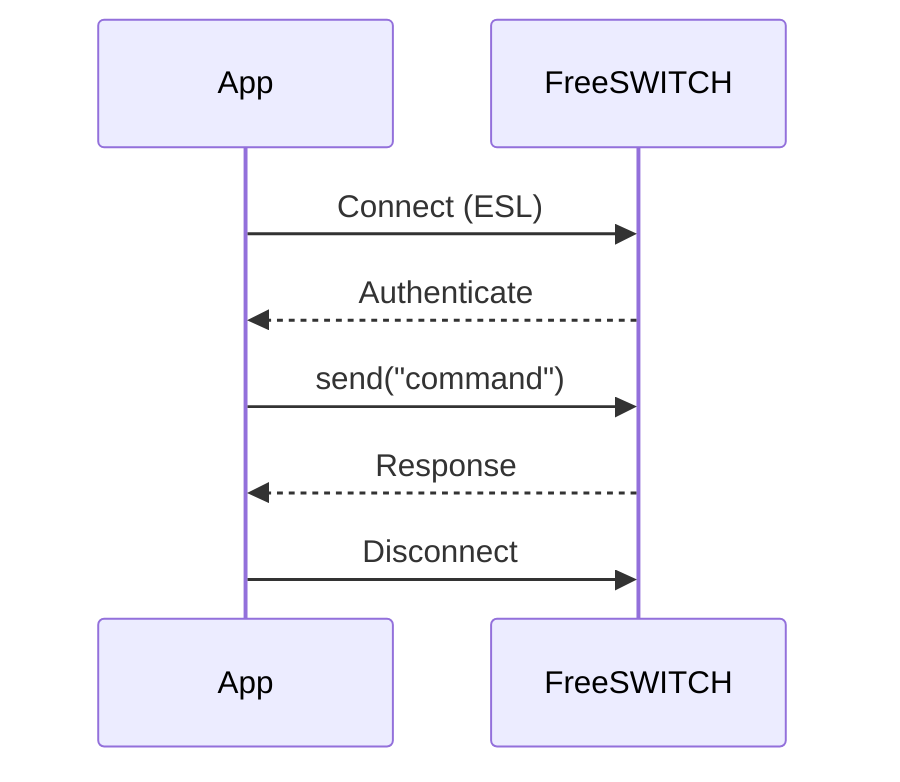

Inbound Socket mode allows you to send commands directly to FreeSWITCH and receive responses asynchronously. This mode is ideal for one-off operations, server queries, and administrative tasks.

## Basic Example

```python
import asyncio
from genesis import Inbound

async def uptime():
    async with Inbound("127.0.0.1", 8021, "ClueCon") as client:
        return await client.send("uptime")

async def main():
    response = await uptime()
    print(response)

asyncio.run(main())
```

## How it works

The `Inbound` class acts as an asynchronous context manager:



{}

### Connection

Establishes a connection to FreeSWITCH at the specified host and port.

### Authentication

Authenticates using the provided password.

### Command Execution

Allows you to send ESL commands using the `send()` method.

### Cleanup

Automatically closes the connection when exiting the context.

{}

## Use Cases

- Querying server status and statistics
- Executing administrative commands
- Triggering actions on FreeSWITCH
- Retrieving channel or call information
- One-time operations that don't require persistent connections

## Lost connection

Catch `ConnectionLost` and end the work on that connection. `stage` is evidence already observed for that wait:

- `NOT_SENT`: `write()` was not called
- `UNCONFIRMED`: `write()` was called, and this wait received no reply
- `ACCEPTED`: the reply was already seen, and the socket dropped while waiting for the command to finish

A delivered `-ERR` is the command result. It does not raise `ConnectionLost`.

Genesis does not retry the command, reconnect the socket, copy handlers, or replay events.

Open a new `Inbound` and call `get_channel(channel_uuid)` when you still want to act on the call. That returns a new `Channel`. The UUID is eight, four, four, four, and twelve hexadecimal digits, separated by hyphens, such as `3814d229-50d9-440e-b91d-8d0801ff615d`. Any other string raises `ChannelError` and is not sent. A channel that is already gone raises `ChannelNotFound`. `uuid` on that error is the id you passed.

`context` on the new channel is the headers from one `uuid_dump`. That dump is not an atomic view of the call, and it is not a history of applications that already ran. Events from before the dump are not applied.

Filters already accepted on that `Inbound` stay there. Genesis does not delete a negative filter. A blocking execute raises `ChannelError` before the command is sent when a negative `Event-Name` or `Unique-ID` filter hides `CHANNEL_EXECUTE_COMPLETE`. The `timeout` argument is not used for that refusal. A negative filter on any other header is not detected, so that wait has no guarantee. See [Live channel lookup]().

The lookup controls a call that is still up. It does not restore an outbound `Session`. After that socket closes, FreeSWITCH continues the dialplan, and the dialplan can end the call before the lookup. See [Lost socket]().

`hangup()` on the new channel is a new command. On inbound it sends `api uuid_kill`. Use it when the surviving call should end.

```python
import asyncio
from genesis import Inbound
from genesis.exceptions import ChannelNotFound, ConnectionLost

CALL = "3814d229-50d9-440e-b91d-8d0801ff615d"

async def control(call_uuid: str) -> None:
    async with Inbound("127.0.0.1", 8021, "ClueCon") as client:
        try:
            channel = await client.get_channel(call_uuid)
            await channel.playback("ivr/ivr-welcome")
        except ConnectionLost as lost:
            # Read lost.stage: NOT_SENT, UNCONFIRMED, or ACCEPTED.
            # This connection ends here. The command is not sent again.
            pass
        else:
            return
    await hangup_if_alive(call_uuid)

async def hangup_if_alive(call_uuid: str) -> None:
    async with Inbound("127.0.0.1", 8021, "ClueCon") as client:
        try:
            channel = await client.get_channel(call_uuid)
        except ChannelNotFound:
            return
        await channel.hangup()

asyncio.run(control(CALL))
```
